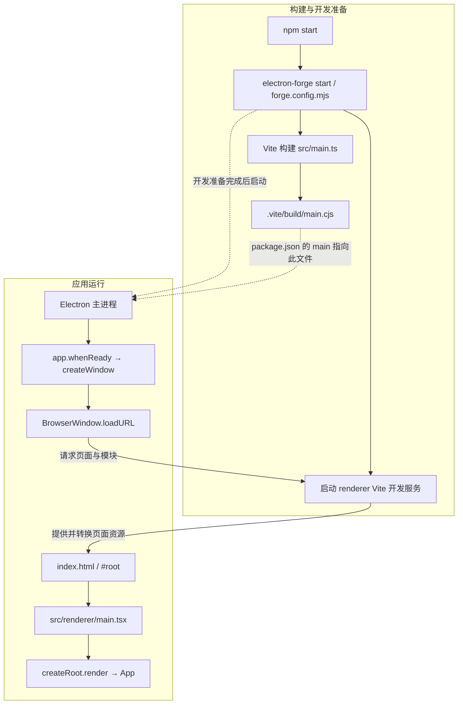

# 静态桌面原型源码导读

日期：2026-11-17。状态：源码导读；静态原型已落地，业务能力尚未实现。

本导读基于编写时 `main` 的源码（`d58d3a6`），解释开发模式中的窗口、三页切换和固定数据展示。今天只核对源码，没有新增运行验收结果；步骤 1、首个设计练习和八组 Token 业务验收案例仍待完成。

返回 [项目首页](../README.md) · 查看 [MVP 执行与学习计划](mvp-plan.md)

## 1. 推荐阅读顺序

先理解一条从启动到显示的路径，再追踪数据。环境准备与启动命令沿用项目首页。

| 顺序 | 源码入口 | 阅读时关注什么 |
| --- | --- | --- |
| 1. 启动配置 | [package.json](../package.json)、[forge.config.mjs](../forge.config.mjs)、[vite.main.config.ts](../vite.main.config.ts)、[vite.renderer.config.ts](../vite.renderer.config.ts) | `start` 调用谁；主进程构建与页面开发服务如何分别配置 |
| 2. 桌面入口 | [src/main.ts](../src/main.ts) | `createWindow`、窗口加载方式和应用生命周期 |
| 3. React 入口 | [index.html](../index.html)、[src/renderer/main.tsx](../src/renderer/main.tsx) | HTML 的 `root` 节点如何挂载 `App` |
| 4. 页面组件 | [src/renderer/App.tsx](../src/renderer/App.tsx) | `App`、`Sidebar`、`ChatPage`、`TokenPage`、`SettingsPage` 的调用关系；三个页面目前都在这个文件中 |
| 5. 演示数据 | [src/renderer/demo-data.ts](../src/renderer/demo-data.ts) | 固定问题、回答、用量及 `totalTokens`、`demoTotals`、`modelShare` 的计算 |
| 6. 基础组件与样式 | [button.tsx](../src/renderer/components/ui/button.tsx)、[input.tsx](../src/renderer/components/ui/input.tsx)、[card.tsx](../src/renderer/components/ui/card.tsx)、[utils.ts](../src/renderer/lib/utils.ts)、[styles.css](../src/renderer/styles.css) | 展示组件如何传递属性；`cn` 如何合并样式类；布局与业务职责如何区分 |

## 2. 从 `npm start` 到页面出现

`package.json` 的 `start` 是 `electron-forge start`。Forge 根据 `forge.config.mjs` 调用 Vite 插件：构建主进程入口，并启动名为 `main_window` 的 renderer 开发服务。`vite.main.config.ts` 将主进程构建为 CommonJS；Electron 读取 `package.json` 的 `main`，执行 `.vite/build/main.cjs`，并不是直接执行 TypeScript 源文件。

下面区分开发准备和应用运行；箭头表示依赖与加载关系，不表示所有步骤严格串行。

`vite.renderer.config.ts` 配置 React 与 Tailwind 插件。开发时页面资源由 Vite 提供，`src/main.ts` 使用 `MAIN_WINDOW_VITE_DEV_SERVER_URL` 加载它们。这里的本地开发服务用于加载界面，不是模型接口或 Python 业务服务。

## 3. 两个入口各自负责什么

**Electron 入口 `src/main.ts` 管理桌面窗口与应用生命周期。** `app.whenReady()` 后设置深色主题并调用 `createWindow()`；窗口默认 1280 × 820、最小 960 × 640，先隐藏，收到 `ready-to-show` 再显示。页面禁用 Node 集成，启用上下文隔离与沙箱。当前没有 preload、业务 IPC 或 Python worker 启动代码。

**React 入口 `src/renderer/main.tsx` 负责挂载界面。** `index.html` 提供 `#root`，入口导入样式并用 `ReactDOM.createRoot(...).render(...)` 在 `React.StrictMode` 内渲染 `App`。这里不创建桌面窗口，也不管理 Electron 的退出。

macOS 上，关闭最后一个窗口和退出应用是两件事：`window-all-closed` 只在非 `darwin` 平台调用 `app.quit()`。在 macOS 上关闭窗口后，应用可以继续运行；再次通过 Dock 激活时，`activate` 回调会在没有窗口的情况下重新创建窗口。新窗口会重新挂载 `App`，回到默认聊天页，这不代表恢复了先前的页面状态。真正退出应用后再启动，也从默认演示内容开始。

## 4. 页面切换：点击改变了什么

在 `App.tsx` 中沿这条链阅读：

1. `App` 用 `useState<Page>("chat")` 保存当前页，初始值是聊天页。
2. `App` 把 `page` 和 `setPage` 传给 `Sidebar`。
3. 导航按钮通过 `onClick={() => setPage(id)}` 更新当前页；示例会话按钮只执行 `setPage("chat")`。
4. React 重新渲染，导航高亮与面包屑读取同一个 `page`；末尾的条件表达式选择 `ChatPage`、`TokenPage` 或 `SettingsPage`。

这是内存状态与条件渲染，没有路由系统，也没有从数据库加载会话。页面切换不会发送模型请求。顶部“静态原型 · 演示数据”位于页面条件分支外，因此三页共用这条提示。

## 5. 演示数据：同一来源如何进入不同视图

`demo-data.ts` 中的 `demoQuestion` 和 `demoCalls` 是人工编写的固定样例，不是供应商响应。`DemoCall` 是当前展示样例的类型，不是未来 API、通信消息或数据库记录的定义。

| 样例 | 输入 Token | 输出 Token | `totalTokens(call)` | `modelShare(call)` |
| --- | ---: | ---: | ---: | ---: |
| DEMO-001 / DeepSeek | 100 | 40 | 140 | 58.33% |
| DEMO-002 / 千问 Qwen | 80 | 20 | 100 | 41.67% |
| 合计 | 180 | 60 | 240 | 100.00% |

`totalTokens(call)` 将一条样例的输入与输出相加。`demoTotals` 用 `demoCalls.reduce(...)` 从零计算整组样例的输入、输出和总量。`modelShare(call)` 用该条总量除以 `demoTotals.total`，再乘 100，并用 `toFixed(2)` 格式化百分比。

回到 `App.tsx`，逐一找这些值的使用位置：

- `ChatPage` 展示 `demoQuestion`，遍历 `demoCalls` 生成回答卡片；每张卡片底部读取 `totalTokens(call)`。
- `TokenPage` 的三张统计卡读取 `demoTotals`；`chartData` 由 `demoCalls.map(...)` 产生，每条的 `value` 是 `totalTokens(call)`，交给 Recharts 的 `Pie` 绘制。
- 图例与图表文字描述读取 `modelShare(call)`；输入输出条形展示读取每条样例的两个 Token 字段。
- 调用明细逐条读取 `demoCalls`，表尾合计与环形图中心都读取 `demoTotals`。

因此，重复打开看板只是再次展示或计算同一组数值，没有“打开一次就加一次”的累计写入。`demoTotals` 是从固定样例派生的值，并不是持久化账本。表格里的“已结算 · 示例”也是展示文字，背后尚无结算、去重、部分用量或未知用量处理。

**当前每个模型恰好只有一条样例。** 尽管函数名是 `modelShare`，它计算的是单条调用占比；`chartData` 也逐条映射，没有先按模型分组。现在单条调用占比恰好等于该模型占比，不能据此认定已支持任意多次调用的按模型聚合。`SettingsPage` 同样从 `demoCalls` 生成供应商卡片，聊天页还写有固定的“2 位参与者”；这些都是阅读扩展问题时需要留意的样例假设。

## 6. 已有界面与尚未实现的能力

聊天输入、发送、停止、新建会话、模型设置、连接测试与保存控件都处于 `disabled` 状态。基础 `Button`、`Input` 组件将原生属性传给对应控件；禁用不只是视觉变灰。当前也没有这些操作的业务处理代码，去掉 `disabled` 并不会获得真实聊天或配置保存能力。

现有代码没有模型请求、聊天持久化、SQLite 或 Keychain 接入。设置页的密钥框只显示占位，不能填写真实密钥。现有架构方向仍以 [ADR 0001](adr/0001-local-desktop-architecture.md) 为准，本导读不增加新的接口与数据结构。

`src/main.ts` 已有无开发服务地址时的 `loadFile(...)` 分支，Forge 配置也有 `packagerConfig: { asar: true }`，但当前 `makers` 为空，尚无独立 `.app` 的交付与验证记录。这些代码和配置说明预留了文件加载与打包配置位置，不能证明 Finder 启动、Python 随包分发或完整 MVP 已完成。

## 7. 用七步主线读现有实现

| 主线 | 在这份代码中寻找的证据 |
| --- | --- |
| 需求 | 当前目标是看见三页布局和固定示例；真实双模型聊天仍是 MVP 目标 |
| 模块 | Electron 管窗口，React 入口挂载界面，`App` 选页面，基础组件负责展示 |
| 数据 | `page` 是内存中的界面状态；`demoCalls` 是展示来源；合计与占比是派生值 |
| 流程 | 分别追踪启动链、导航点击链，以及样例到卡片、图表和明细的读取链 |
| 并发与一致性 | 当前没有并发模型调用或业务写入；共用样例让视图可相互核对，但不等于已经实现流式事件去重 |
| 异常处理 | 当前没有请求失败、取消、用量缺失与业务恢复逻辑；禁用控件和固定成功样例不能作为这些行为的验证证据 |
| 扩展与验证 | 检查“一模型一条样例”的前提；真实业务仍需按 [Token 用量验收样例](token-usage-examples.md) 验证，八组案例保持未执行 |

本次核对只覆盖源码路径、函数关系、计算与文档表述，不替代应用运行或业务验收，也不改变原定开发阶段。

## 8. 三个阅读自查问题

1. 从导航按钮追踪到页面出现，哪些函数参与了页面切换？为什么这条路径不会调用 AI？
2. 在聊天页与 Token 看板间来回切换，为什么演示总量始终是 240，而不会随展示次数增加？请指出数据来源和计算位置。
3. 如果给同一模型增加第二条样例，哪些关于调用、模型、参与者和配置卡片的假设需要重新检查？哪些总量计算仍然成立，哪些展示含义可能改变？

这些问题用于读懂已有原型。下一项业务设计仍从 [MVP 计划中的首个设计练习](mvp-plan.md#8-首个设计练习) 开始，保留先提出自己的方案、再逐步评审的方式。
